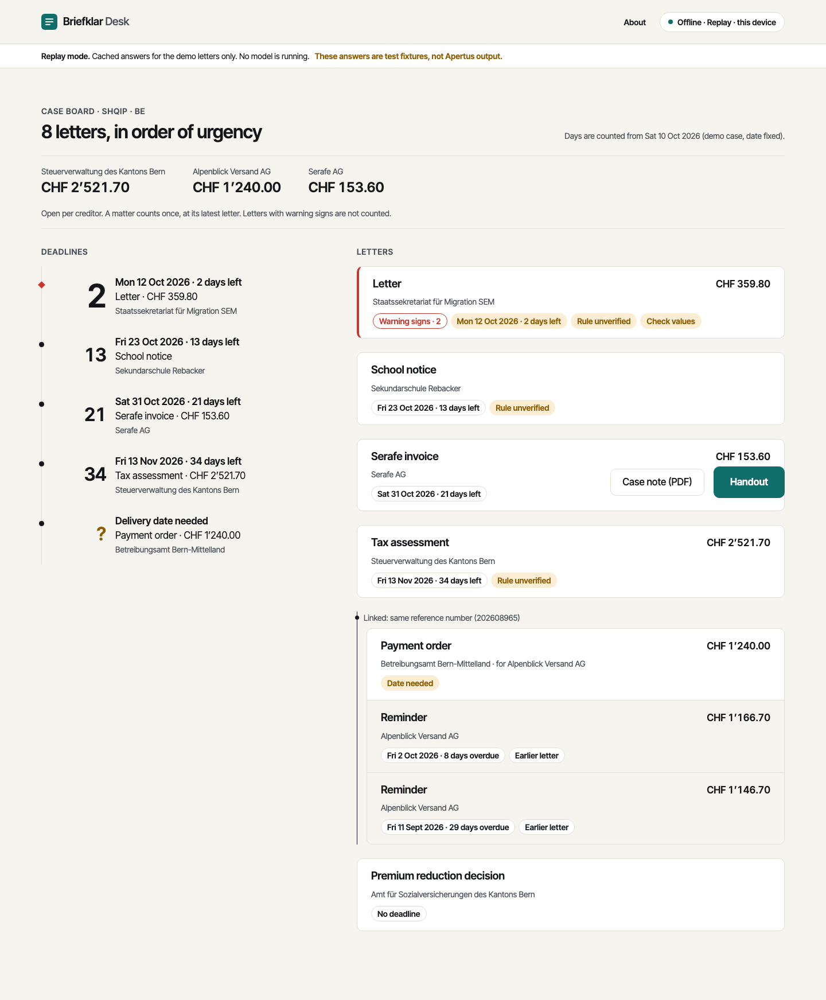

# Briefklar Desk

> Briefklar Desk turns the pile of Swiss official letters a client brings to a help desk into a
> deadline-ordered case plan, warning signs, ready-to-sign replies, and an explanation in the client's
> own language. It runs on Apertus 1.5 8B on the help desk's own hardware, with no network at runtime.



## Quick Execution for Judges

Only Docker is needed. From the repository root:

```bash
make run
```

What happens:

1. The app image is built (frontend and backend, a few minutes the first time).
2. `briefklar.verify` re-runs the deterministic parts (deadline engine, tools, thread linker, scoring) on the
   cached model outputs for `data/bench_small` and prints a table. It must end with
   `OK: cached outputs reproduce the committed summary exactly.`
3. The app starts in **replay mode** on **http://localhost:8080**. No GPU, no network.

In the app: **New case** → pick a language → **Start with the demo letters** → **Read letters**.
Open the payment order, enter the delivery date **8 Oct 2026**, and the deadline becomes
**Mon 19 Oct 2026, 9 days left**, with the rule trace. Then **Draft: Rechtsvorschlag**, **Handout**, **End case**.

### Read this before judging the numbers

No GPU and no Apertus endpoint were available while this build was made. Until `make record-live` has
been run against Apertus:

- `data/replay/` holds **fixture responses**: written by `bench/fixtures/` from the generator's gold data,
  **not produced by Apertus**. The app header and `data/replay/MANIFEST.json` say so.
- Everything else is real and runs for real: pre-processing, OCR, QR decoding, the deadline engine, IBAN and
  QR-bill checks, the red-flag checks, the thread linker, the ordering, the printouts, and the UI.
- The evaluation table therefore shows **B0 (Tesseract + regex) as a real measurement** and **BK on perfect
  extraction** (what the deterministic parts do when Pass 1 is right). **No number describes Apertus yet.**
  B1 to B3 are reported as `not run`.

A real run was attempted on 14 October with `bench/kaggle/apertus_kaggle.ipynb` (Apertus 8B Instruct 2509,
vLLM 0.31.0, Kaggle 2 × T4). The weights loaded, but the vLLM engine crashed during start-up on the T4 GPUs
(compute capability 7.5), and a retry also failed, so no Apertus numbers exist. Technical report, section 6,
lists this and the earlier failed attempts.

To replace the fixtures with real model output:

```bash
# .env: BRIEFKLAR_MODE=live, LLM_BASE_URL=<Apertus endpoint>, LLM_NAME=<served name>
make record-live     # runs the pipeline on the demo case and bench_small, writes data/replay/
make eval            # recomputes bench/eval/results/ from the recorded responses
make run
```

## Other commands

| Command | What it does |
| --- | --- |
| `make gpu-up` | Local vLLM with Apertus 1.5 8B plus the app. Needs an NVIDIA GPU with 24 GB and the weights in the Hugging Face cache. The model server sits on an internal Docker network with no route out |
| `make run-live` | The app against the endpoint in `.env` (`LLM_BASE_URL`), e.g. a Swiss-hosted Apertus |
| `make test-code` | 149 backend tests: deadline engine against 36 hand-computed cases, tools, pipeline golden test, network isolation, colour contrast |
| `make test` | The same plus 10 tests that **fail on purpose** until a person fills in official sources (see below) |
| `make test-ui` | Browser tests: photos to printed objection with the keyboard, accessibility scan on every screen, Arabic RTL and Tigrinya |
| `make eval` / `make eval-live` | Metrics from cached responses / re-run against live endpoints |
| `make bench` | Regenerate the 150 synthetic letters, 20 case bundles and gold |

## What is in here

| Path | Content |
| --- | --- |
| `src/briefklar/pipeline/` | Pass 1 extract, Pass 2 verify (tool loop), Pass 3 explain, Pass 4 back-translation check, case pass with the deterministic linker, reply pass |
| `src/briefklar/tools/` | Deadline engine (SchKG Art. 31, 56, 63), IBAN, QR-bill parser, authority directory, red-flag checks |
| `src/briefklar/llm/client.py` | The one module that calls the model: `LLM_NAME`, `LLM_BASE_URL`, `LLM_API_KEY`, replay cache |
| `src/briefklar/knowledge/` | Authority directory, explainer cards, reply templates, scam patterns, client-language strings, language lights |
| `frontend/` | SvelteKit app. Fonts are self-hosted; the bundle references no external origin (tested) |
| `bench/generator/` | Swiss Letters Bench v0: synthetic letters, capture degradations, gold |
| `bench/eval/` | Metrics, baselines, results |
| `bench/fixtures/` | The fixture backend used until Apertus has been run |
| `data/demo/`, `data/bench_small/`, `data/replay/` | Demo case, judge-facing bench subset, cached responses (6 MB in total) |
| `technical_report.md` | Architecture, use of Apertus, data, evaluation, limitations |

## Open items a person must close

The spec forbids inventing legal rules, deadlines or contact data. Wherever an official source is still
needed there is a `TODO(source)` and a failing test in `tests/test_sources_required.py`:

- Authority contacts: all 20 entries in `knowledge/authorities.yaml` are sourced (re-read on their pages on
  2026-10-12), so the "contact differs from the directory" check is on. A person should still look at them once.
- Explainer cards: written for payment order (de, fr, it), Serafe invoice (de, fr, it) and premium reduction
  (de, Bern only). The other letter types, and the missing languages, still need a card from an official sheet.
- The fixed objection sentence in French and Italian is filled with one plain sentence that uses only the terms
  of the official pages (vd.ch, ti.ch, federal sheet). No sheet prescribes a formula, so a lawyer should confirm
  both before real use (`TODO(source)` in the templates).
- Legal appeal periods for tax, fine, premium-reduction, permit and rent letters (their bench letters carry a
  printed date only).
- Inclusive bounds of the debt-enforcement holidays, and the counting rule for administrative deadlines
  (both shown as "rule unverified" in the app).
- Native-speaker review of the fixed client-language strings in `knowledge/i18n.yaml`.

Also still to do by the team: record real Apertus responses, run B1 to B3 and the judge, native-speaker checks,
language lights, pin the vLLM image digest, the moodboard screenshots, the video, and the PDF of the report.

## Deviations from the build spec, and why

- **Recording is opt-in** (`BRIEFKLAR_RECORD=1`). The spec writes every live response to `data/replay/`; on real
  client letters that would break the no-persistence rule.
- **The model writes a date token, code writes the date.** Pass 3 emits `[[DUE_DATE]]`; the deadline engine's
  date is put in afterwards, localised with its weekday. The model cannot alter a date, and entering the
  delivery date needs no second model call.
- **Pre-processing results are cached with the responses** (keyed by the upload's SHA-256), so replay is
  bit-identical across machines and Tesseract builds.
- **Thread order and linking are refined.** A matter is ranked by its latest letter, and contradicting
  reference numbers veto the two fuzzy link rules. Without this, two invoices from one creditor were merged.
- **With warning signs, the "what you can do" section is replaced by a fixed "wait for the counsellor" line**,
  and no reply is offered.
- **Language lights have a fourth state, "not measured"**, because nothing has been measured yet.
- Uploaded PDFs are rasterised on the server (pypdfium2), so pdf.js is not bundled.
- Bench wording lives in one YAML file per letter type and language, rendered through one HTML layout.

---

# Track 2 B: Own Project

Bring your own idea and build a working Apertus prototype that tackles a problem you care about — any domain, any use case. The project must be new, started within the hackathon period.

Submissions must use the Apertus model family.
For Track 2 this means that submitted solutions must be built with Apertus. Other open-weights models can be used to support development, e.g. as automatic judges during evaluation. Their role must be clearly described in the submission report.

💬 In case you have questions, join the conversation on [Discord](https://discord.gg/hack-apertus) or send an email to “hello@hackapertus.ch”

---

## 🔧 Resources & Tools

Check our resources & tools page for detailed information:
https://hackapertus.notion.site/resources-tools

| Models           | URL                                      |
|------------------|------------------------------------------|
| Apertus v1.5 8B  | [huggingface.co/swiss-ai/Apertus-v1.5-8B](https://huggingface.co/swiss-ai/Apertus-v1.5-8B)  |
| Apertus v1.5 70B | [huggingface.co/swiss-ai/Apertus-v1.5-70B](https://huggingface.co/swiss-ai/Apertus-v1.5-70B) |


## Target architecture (mandatory)

Whatever you build in Track 2B must be deployable in one of these three architectures:

- **a) On-premise** — on the organisation's own infrastructure, under its own administration.
- **b) Air-gapped** — with no external network connection at runtime.
- **c) Sovereign Swiss cloud** — on a cloud platform operated in Switzerland, under Swiss jurisdiction, with Swiss data residency.

---

## Data

The `data/` directory must not exceed 100 MB.

---

## 📦 Submission Requirements & Deliverables

❗️ Submissions are not handled on Devpost but via this URL only:
http://hackapertus.ch/online-hack/submissions

The submission must: 
1. follow the template repo and include all prerequisite files and definitions
2. follow the specified input/output formats
3. run in a Docker container, launched with `make run` from the root of the project
4. run end-to-end when judges try to run it

### Git repo (URL)
- Create your repo from this template (**Use this template**) and work in the `track_2b/` challenge directory. Delete the other track challenge directories.
- Keep `track_2b/` as it is: don't rename it or move its files.
- Set the repo to PUBLIC (Settings --> Collaborators --> Manage Visibility)
- Submit the URL of YOUR Git repo.

### Technical Report (pdf)
- Update [technical_report.md](technical_report.md) in this repository with all the details for your submission.
- Upload a pdf of your technical report to this directory, named as `TeamName_Report.pdf`.
- Format: pdf, max. 6 pages w/o references
- Submit the pdf of the technical report.

### Demo video (URL)
- Max. 2 min demo video of your prototype

### Dataset (URL) - optional, depending on your project
Submitted datasets must comply with our guidelines for responsibly sourced datasets.

- Create a user account on Hugging Face
- Clone our dataset template on Hugging Face: https://huggingface.co/datasets/HackApertus/online_hack_template
- Complete the dataset card with all required information
- Upload your dataset. It should consist of the following components:
    - evaluation dataset (i.e. individual test cases)
    - model response dataset (i.e. the model response to each test case)
    - metadata file (i.e. additional information about each test case; where relevant, this file must contain instance-level licensing information) 
- Make sure your dataset access control is set to PUBLIC
- Provide the URL of _your_ data set


---

## ⚖️ Judging Criteria

1. Purposeful use of AI
2. Technical rigour
3. Value, cost & scalability
4. Sovereign deployability
5. Implementation feasibility

Judges use a Scale 0–5 per dimension.

---

## Support

**Licensing requirements**
Please check our Terms & Conditions (6. What you build is open source):
https://hackapertus.ch/terms-and-conditions

## FAQ
💡 https://hackapertus.ch/faq

## Contact
💬 In case you have questions, join the conversation on Discord or send an email to “hello@hackapertus.ch”
