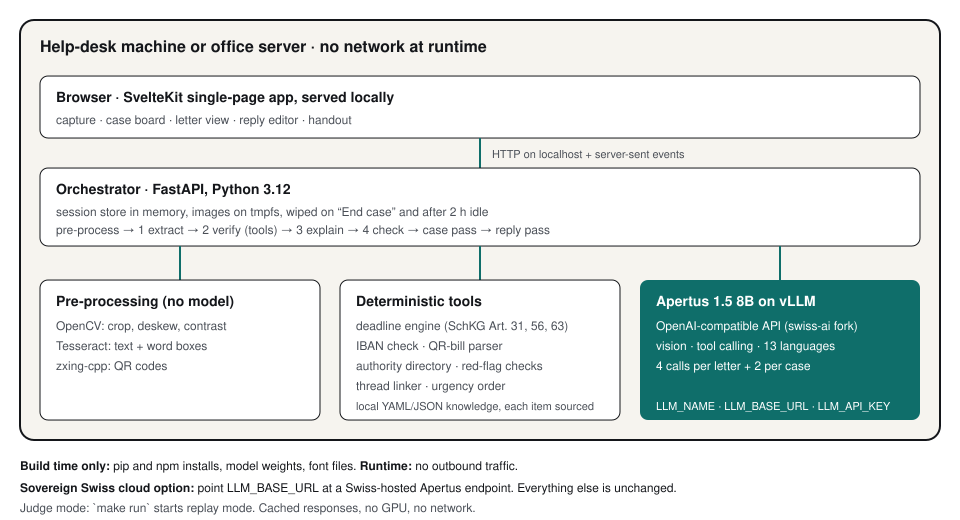

# Technical report — Briefklar Desk

- **Track:** Track 2B — Briefklar Desk
- **Event:** Online
- **Team:** `team name` — `member`, `member`, `member`
- **Demo:** `link to video`
- **Status of this document:** no Apertus run succeeded before the deadline (see section 6). Every number
  that needs the model is marked *not measured*.

## 1. Summary

People bring Swiss help desks (Schreibdienste, social services, debt advice, integration offices) a bag of
official letters they cannot read well. Some carry short, hard deadlines: a payment order must be opposed
within 10 days of delivery. Fake authority letters circulate. And staff may not put this data into public AI
tools. Consumer apps explain one letter at a time, in the cloud, for an individual.

Briefklar Desk is a web app for the counsellor that runs on one machine in the office. It reads every letter
the client brought (Apertus 1.5 8B vision, cross-checked with OCR), computes each deadline with deterministic
Swiss rules, links letters into matters, orders the case by urgency, lists evidenced warning signs, drafts
replies from vetted templates, and explains each letter in the client's language with a simple-German twin.
It prints a one-page handout and a German case note, then wipes the session.

**Headline result: not measured yet.** No GPU or Apertus endpoint was available during the build. What is
measured today is the non-AI floor (B0) and the behaviour of the deterministic parts on perfect extraction
(section 5).

## 2. Architecture

One container serves the browser app and the orchestrator (FastAPI). Per letter there are four Apertus calls,
per case two; everything that can be computed is computed in code.

| Step | Who | What |
| --- | --- | --- |
| Pre-process | code | crop, deskew, contrast (OpenCV); text with word boxes (Tesseract deu+fra+ita); QR codes (zxing-cpp) |
| Pass 1 Extract | Apertus, vision | `LetterFacts` JSON with an evidence phrase per field; phrases are aligned to OCR word boxes for highlighting |
| Pass 2 Verify | Apertus, tool calling | calls `compute_deadline`, `validate_iban`, `decode_qr_bill`, `lookup_authority`, `match_scam_patterns`; the orchestrator runs any required tool the model skipped and records that |
| Pass 3 Explain | Apertus, thinking on | five sections in the client language and in simple German; every sentence cites evidence ids or an explainer card |
| Pass 4 Check | Apertus + code | back-translation to German, chrF against the German twin, and a field check on date, amount and sender |
| Case pass | Apertus + code | the model proposes threads and an order; a deterministic linker confirms links; the final order is deterministic |
| Reply pass | Apertus + code | fills template slots from facts; fixed wording is never generated |

Guarantees enforced in code rather than by prompt: the model never writes a deadline date (it writes a token
that the engine's date replaces); unsupported sentences are dropped; a letter with warning signs gets a fixed
"wait for the counsellor" line instead of its own options, and no reply; red flags are evidence lists, never a
verdict.

### Target architecture (mandatory)

- **b) Air-gapped — primary.** `make gpu-up` starts vLLM with Apertus 1.5 8B and the app on one machine. The
  model server is on an internal Docker network with no route out; the weights are read from the local
  Hugging Face cache (`HF_HUB_OFFLINE=1`). The app container has a read-only file system; images live on tmpfs.
- **a) On-premise.** The same compose file on an office server; browsers on the office LAN.
- **c) Sovereign Swiss cloud.** Set `LLM_BASE_URL` to a Swiss-hosted Apertus endpoint. Nothing else changes.

**Build time:** pip and npm packages, model weights, font files. **Runtime:** no outbound traffic except to
`LLM_BASE_URL`. This is tested: outbound sockets are blocked while the demo case is processed
(`tests/test_no_network.py`), the built frontend is scanned for external origins, the browser test records
every request, and the server sends a same-origin Content-Security-Policy. Fonts are self-hosted.

## 3. Use of Apertus

- **Model:** `swiss-ai/Apertus-v1.5-8B` for all product inference. `swiss-ai/Apertus-v1.5-70B` is planned as
  reader and judge in the evaluation only. No other model is used; Tesseract is OCR, not a model substitute.
- **How it is used:** inference with vision input, tool calling, multilingual generation.
- **Where it runs:** local weights on vLLM (image `ghcr.io/swiss-ai/vllm_apertus_1.5_release`, digest to be
  pinned), flags `--max-model-len 16384 --enable-auto-tool-choice --tool-call-parser apertus
  --reasoning-parser apertus`.

All calls go through `src/briefklar/llm/client.py` (`LLM_NAME`, `LLM_BASE_URL`, `LLM_API_KEY`), with
temperature 0 and a fixed seed. Thinking is on only in Pass 3, because tool calling is not supported in
thinking mode. JSON schemas are sent as `response_format` and also validated with Pydantic, with one retry
that carries the validation error. Prompts are in `src/briefklar/llm/prompts/`.

**Not yet verified against the real server** (the gate test in the build plan): the image content-part
format, the tool-call parser, and guided JSON decoding. Each has a fallback: only `client.py` changes for the
image format, the orchestrator already calls required tools itself, and `BRIEFKLAR_GUIDED_JSON=0` switches to
prompted schemas.

## 4. Data

**Swiss Letters Bench v0** is synthetic: 150 letters in 20 case bundles (5 to 10 letters each, reminder chains
that escalate into a payment order, a letter with warning signs in 6 bundles), in three capture qualities.
Real client letters contain sensitive personal data and cannot be published; synthetic letters have exact gold
and no personal data. People, addresses, companies and references are fictional (Faker, seed 7); IBANs are
checksum-valid test numbers; letterheads are text only; every page says it is a synthetic test letter.

Gold due dates come from the product's deadline engine, which is checked independently against 36
hand-computed cases (`tests/data/deadline_cases.csv`: weekend roll-over, cantonal holidays, both edges of
each debt-enforcement holiday window, month periods in leap and non-leap years).

Sources: the payment order wording and its 10-day period follow the official information sheet of the
Betreibungsamt Thurgau; the warning-sign pattern follows public reports on fake SEM letters. Templates of other
types are team-written and carry a printed date only, because their legal appeal periods have not yet been
copied from official forms. Licence: CDLA-Permissive-2.0. `data/` in the repository is 6 MB (demo case and a
23-letter subset); the full set is generated by `make bench` for upload to Hugging Face.

## 5. Evaluation

Systems: **B0** Tesseract + regex (non-AI floor); **B1** OCR + Apertus plain translation (what a
translate-the-photo tool gives a reader); **B2** OCR text + Apertus explanation (value of vision); **B3**
Apertus vision without tools, letter by letter (value of tools and case-level reasoning); **BK** the full
pipeline. Headline metric: *action correctness*, the share of letters where a reader gets both the exact due
date and the right next step.

Subset `data/bench_small` (23 letters, 3 cases, phone-photo quality):

| Metric | B0 measured | B1 | B2 | B3 | BK with Apertus | BK on perfect extraction* |
| --- | --- | --- | --- | --- | --- | --- |
| Action correctness | 0.39 | not run | not run | not run | not measured | 1.00 |
| Deadline, exact date | 0.48 | — | — | not run | not measured | 1.00 |
| Letter type | 0.83 | — | — | not run | not measured | 1.00 |
| Field F1 | 0.65 | — | — | not run | not measured | 1.00 |
| Warning signs, recall | 0.00 | — | — | not run | not measured | 1.00 |
| Triage order, Kendall τ | — | — | — | not run | not measured | 1.00 |
| Thread linking F1 | — | — | — | not run | not measured | 1.00 |
| Open total per creditor | — | — | — | — | not measured | 1.00 |
| Reply completeness | — | — | — | — | not measured | 1.00 |

\* *Fixture responses built from gold, not Apertus output.* This column only shows that, given correct
extraction, the deadline engine, red-flag checks, linker and ordering reproduce the gold. It is an upper
bound by construction and must not be quoted as a result. The French and Italian objection sentences use only the
terms of the official sheets (vd.ch, ti.ch, federal sheet) and still await a lawyer's confirmation.

What B0 tells us already: regular expressions find the letter type (0.83) but get
the exact deadline right in only 0.48 of letters, because the date depends on delivery,
weekends and holidays, and they see no warning signs at all.

A finding from building the harness: the linking rule "a payment order belongs to a reminder from the same
creditor" merged two separate invoices of one creditor into one matter. The linker now lets
contradicting reference numbers veto the fuzzy rules.

**Not measured yet:** BK and B1 to B3 with Apertus; faithfulness (judge model) and judge-human agreement;
back-translation chrF per language and native-speaker checks, hence all language lights show "not measured";
seconds and CHF per case on one 24 GB GPU; orchestrator-forced tool calls and schema retries.

## 6. Limitations

- **No model results yet.** Vision quality on phone photos, tool calling and guided JSON in the vLLM fork are
  all unverified. Three attempts to get real Apertus output failed: Apertus 1.5 could not be loaded with the
  public Transformers release (unknown model type); a local 4-bit MLX build of Apertus 8B on a 16 GB laptop
  answered in prose instead of JSON and its server died after one to three requests; and on 14 October
  `swiss-ai/Apertus-8B-Instruct-2509` with vLLM 0.31.0 on Kaggle (2 × T4, fp16, tensor parallel 2) loaded the
  weights but the engine crashed in its start-up profiling run on these compute-capability-7.5 GPUs, and a retry
  also failed. The notebook is `bench/kaggle/apertus_kaggle.ipynb`; it should be re-run on a GPU with compute
  capability 8 or higher.
- **Wrong extraction is possible.** The OCR cross-check flags amounts, IBANs, references and dates that the
  model and OCR read differently, and every sentence links to its source span, but a counsellor must review.
- **Only SchKG deadline rules are implemented as verified.** Administrative deadlines are computed and shown
  with an amber "rule unverified" note. The inclusive bounds of the debt-enforcement holidays are not
  confirmed, so deadlines touching a window are also shown as unverified.
- **The authority directory has no sourced contacts yet**, so one of the seven warning-sign checks is off and
  the app says "official contact not yet sourced".
- **Low-resource languages.** Quality for Tigrinya, Tamil and others is unknown. The fixed client-language
  strings were not reviewed by native speakers.
- **Synthetic-only evaluation**, with one page layout and limited French and Italian templates.
- **Misuse.** The tool states facts, computed dates and options printed on the letter. It gives no legal
  advice and never says a letter is fake or genuine. Out of scope: handwriting, Romansh, sending anything to
  authorities, storing cases.

## 7. Reproducibility

`make run` (Docker only) builds the image, runs `briefklar.verify`, which recomputes the subset results from
`data/replay/` and fails on any difference from `bench/eval/results/summary_small.json`, then starts the app
in replay mode. `make eval` recomputes all results without a GPU; `make eval-live` re-runs the systems.
`make test-code` runs 149 tests. Seeds: generator 7, model seed 7, temperature 0. Hardware for live runs: one
24 GB GPU. Commit: `fill in`. vLLM image digest: `fill in`.

## 8. Next steps

Run the gate test and record real responses; run B1 to B3 and the judge on all 150 letters; native-speaker
checks and language lights; fill the sourced items (authority contacts, explainer cards, appeal periods);
pilot with a Swiss help desk on real letters under their data rules; more letter types and Romansh;
integration with a canton's internal AI platform; measured cost per case at scale.

## License

Creative Commons Attribution 4.0 (CC-BY-4.0). All HackApertus projects are open-sourced.

## References

- Hack Apertus project template and Track 2B rules: https://github.com/HackApertus/project-template
- Apertus v1.5 8B model card: https://huggingface.co/swiss-ai/Apertus-v1.5-8B
- Payment order information sheet, Betreibungsamt Thurgau (10-day objection, Art. 33, 56, 63 SchKG): https://betreibungsamt.tg.ch/public/upload/assets/92744/Informationsblatt%20zum%20Zahlungsbefehl%20de.pdf
- SchKG Art. 31, 56, 63: https://law.ch/lawinfo/fristen/schuldbetreibungs-und-konkursrecht-schkg/gesetzliche-grundlagen/
- Reports on fake SEM letters: https://www.iamexpat.ch/expat-info/swiss-news/fake-deportation-letters-being-sent-expats-switzerland-sem-warns
- Basel-Stadt AI directive for staff: https://www.bs.ch/schwerpunkte/daten/databs/schwerpunkte/kuenstliche-intelligenz/ki-richtlinie
